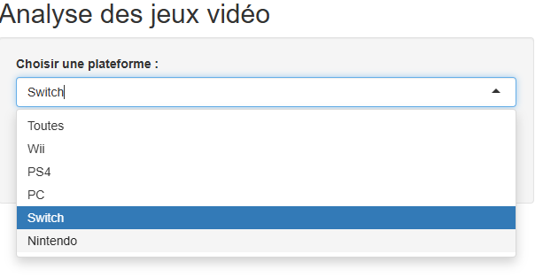
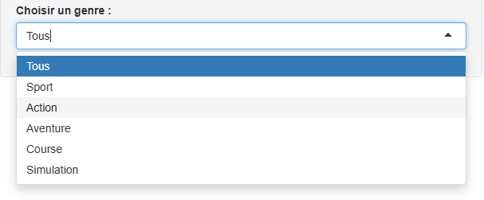
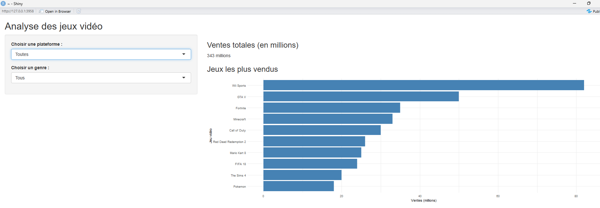
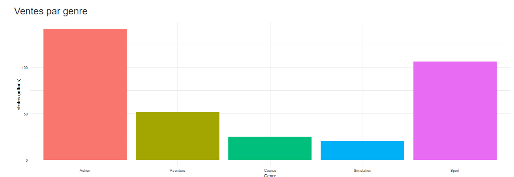
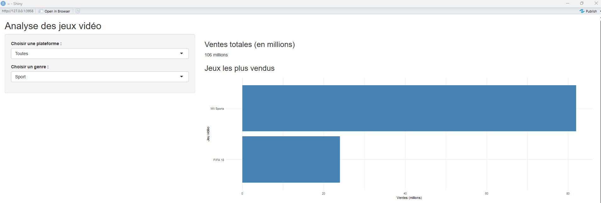
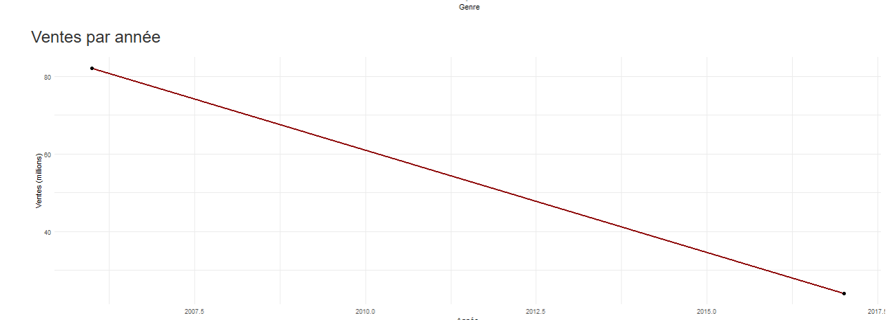
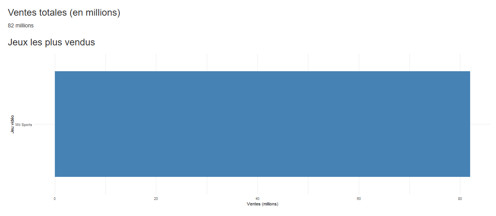
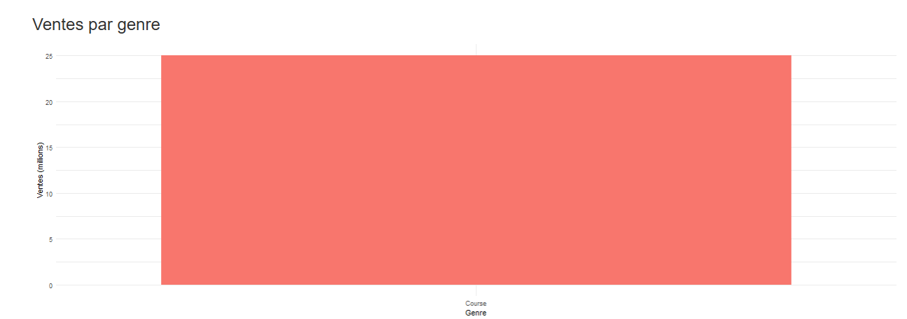

# Analyse des jeux vidéo avec R Shiny

## 1. Présentation du projet

Ce projet consiste à créer un tableau de bord interactif avec R Shiny pour analyser les ventes de jeux vidéo.

## 2. Outils utilisés

- R
- RStudio
- Shiny
- ggplot2
- dplyr

## 3. Fonctionnalités

- Affichage des ventes totales en millions.
- Classement des jeux les plus vendus.
- Analyse des ventes par genre.
- Visualisation des ventes par année.
- Filtres interactifs par plateforme et par genre.

## 4. Captures d'écran

### Vue générale du dashboard

### Sélection des plateformes

### Sélection des genres

### Ventes par genre

### Dashboard filtré par genre

### Ventes par année

### Résultats filtrés

### Graphique des ventes

## 5. Conclusion

Ce projet m'a permis de mettre en pratique la visualisation de données et de découvrir la création d'un tableau de bord interactif avec R Shiny.

**Remarque :** les données utilisées sont des données d'exemple et ne représentent pas nécessairement les ventes réelles des jeux vidéo.
