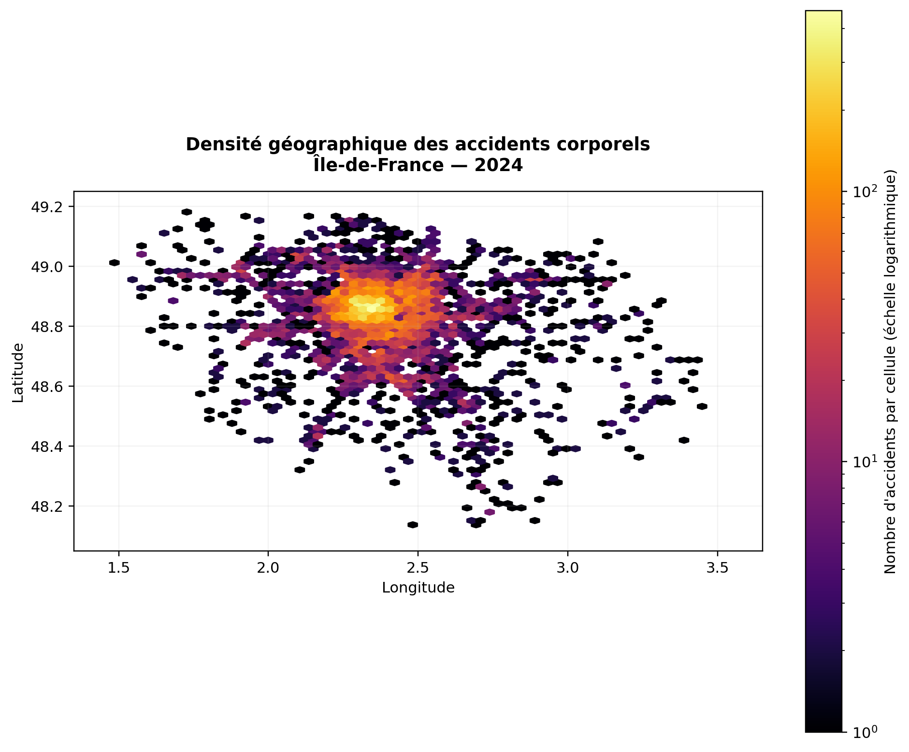
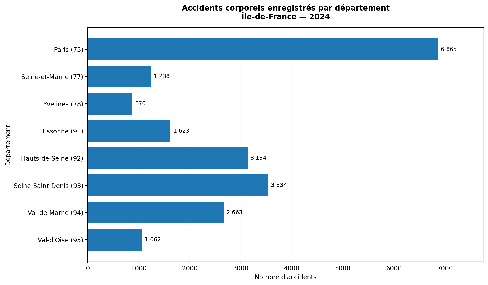
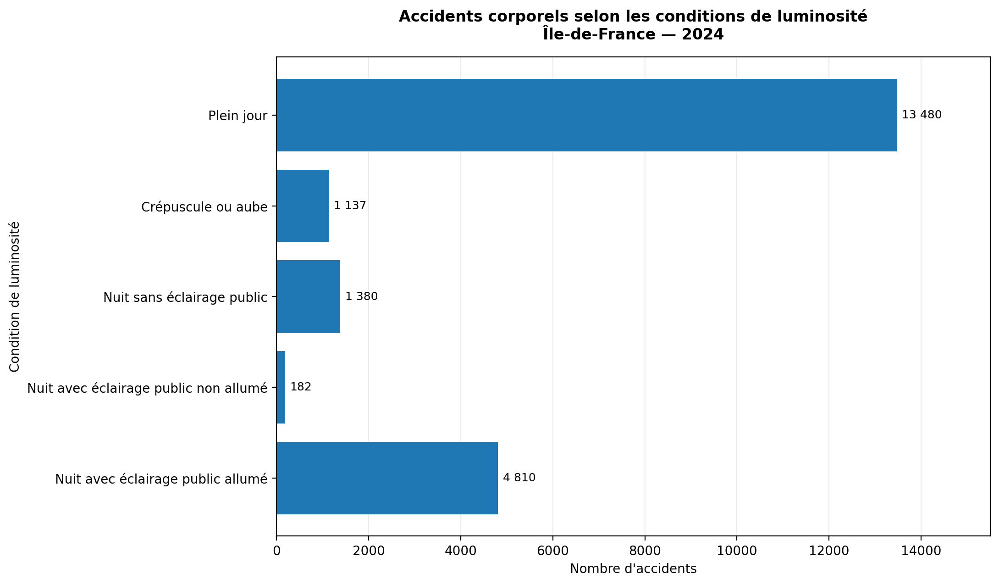

# Analyse cartographique des accidents corporels de la circulation en Île-de-France (2024)

## 1. Présentation du projet

Ce projet étudie la répartition géographique des accidents corporels de la circulation routière en Île-de-France pendant l'année **2024**. L'objectif est de repérer les zones où les accidents sont les plus nombreux et de comparer les effectifs selon deux dimensions : le département et les conditions de luminosité.

- **Territoire étudié :** Île-de-France (départements 75, 77, 78, 91, 92, 93, 94 et 95).
- **Période :** année 2024.
- **Source :** bases de données annuelles des accidents corporels de la circulation routière (BAAC), publiées sur [data.gouv.fr](https://www.data.gouv.fr/datasets/bases-de-donnees-annuelles-des-accidents-corporels-de-la-circulation-routiere-annees-de-2005-a-2025).
- **Outils :** Python, Pandas, Matplotlib et Folium.

L'unité comptée dans cette analyse est **l'accident corporel enregistré** dans la base BAAC. Il ne s'agit ni du nombre de victimes ni d'un taux de risque individuel.

## 2. Téléchargement et exploration des données

Deux fichiers CSV de l'année 2024 ont été utilisés :

| Fichier | Variables utiles |
|---|---|
| `caract-2024.csv` | `Num_Acc`, `jour`, `mois`, `an`, `lum`, `dep`, `com`, `lat`, `long` |
| `lieux-2024.csv` | `Num_Acc`, `catr`, `voie`, `circ`, `nbv`, `prof`, `plan`, `surf`, `infra`, `situ`, `vma` |

Le fichier « caractéristiques » contient notamment la date, le département, les conditions de luminosité et les coordonnées géographiques. Le fichier « lieux » décrit l'environnement routier de l'accident.

Les deux tables ont été rapprochées grâce à la variable commune **`Num_Acc`**, qui identifie chaque accident. Les coordonnées `lat` et `long` permettent de placer les accidents sur une carte.

## 3. Nettoyage et préparation

Les traitements suivants ont été réalisés avec Pandas :

1. Lecture des deux fichiers CSV.
2. Jointure des tables sur `Num_Acc` avec une jointure interne (`inner`) afin de ne conserver que les accidents présents dans les deux fichiers.
3. Filtrage des départements franciliens : 75, 77, 78, 91, 92, 93, 94 et 95.
4. Conversion des coordonnées en valeurs numériques. Les virgules décimales éventuelles sont remplacées par des points.
5. Suppression des lignes sans latitude ou longitude exploitable et contrôle de la cohérence générale des coordonnées.
6. Conversion de la variable `lum` en catégories lisibles pour les graphiques.

**Bilan du nettoyage :** après jointure et filtre géographique, **20 989 accidents** sont conservés. Les **20 989** enregistrements disposent de coordonnées exploitables pour la carte.

### Variables retenues

| Variable | Utilisation |
|---|---|
| `Num_Acc` | Identifiant permettant de relier les fichiers |
| `dep` | Comparaison des effectifs par département |
| `lum` | Comparaison selon la luminosité |
| `lat` et `long` | Localisation géographique |
| `jour` et `mois` | Informations temporelles disponibles pour décrire les accidents |

Les autres variables décrivant la route (type de voie, profil, surface, etc.) pourraient être étudiées dans une analyse complémentaire, mais elles ne sont pas nécessaires aux visualisations principales présentées ici.

## 4. Première visualisation : carte de répartition géographique

La première visualisation représente la densité géographique des accidents corporels en Île-de-France en 2024.



**Choix graphique :** une carte de densité par cellules hexagonales (*hexbin*) a été réalisée à partir des coordonnées longitude/latitude. Chaque cellule représente un secteur géographique ; plus elle concentre d'accidents, plus sa valeur est élevée. L'échelle de couleur est logarithmique afin de rendre visibles à la fois les zones très concentrées et les zones moins denses.

Cette représentation est adaptée à un grand nombre de points : elle évite de superposer des milliers de marqueurs individuels et permet de faire ressortir les concentrations spatiales.

Une carte interactive avec regroupement des marqueurs est également disponible : [ouvrir la carte interactive](images/carte_interactive_accidents_idf_2024.html).

## 5. Deuxième visualisation : comparaison par département

Le graphique suivant compare le nombre d'accidents corporels enregistrés dans chacun des huit départements franciliens.



| Département | Nombre d'accidents | Part du total |
|---|---:|---:|
| Paris (75) | 6 865 | 32,7 % |
| Seine-et-Marne (77) | 1 238 | 5,9 % |
| Yvelines (78) | 870 | 4,1 % |
| Essonne (91) | 1 623 | 7,7 % |
| Hauts-de-Seine (92) | 3 134 | 14,9 % |
| Seine-Saint-Denis (93) | 3 534 | 16,8 % |
| Val-de-Marne (94) | 2 663 | 12,7 % |
| Val-d'Oise (95) | 1 062 | 5,1 % |
| **Total** | **20 989** | **100 %** |

**Interprétation :** Paris présente l'effectif le plus élevé avec 6 865 accidents, soit environ un tiers du total francilien. La Seine-Saint-Denis arrive ensuite avec 3 534 accidents, suivie des Hauts-de-Seine avec 3 134. Les Yvelines ont l'effectif le plus faible (870).

Ces résultats décrivent des volumes enregistrés. Ils ne permettent pas, à eux seuls, d'affirmer qu'un département est plus dangereux qu'un autre : la population, la densité de circulation, la longueur du réseau routier et les déplacements effectués diffèrent selon les territoires.

## 6. Analyse complémentaire : comparaison selon la luminosité

La seconde comparaison choisie porte sur les conditions de luminosité au moment de l'accident.



| Condition de luminosité | Nombre d'accidents | Part du total |
|---|---:|---:|
| Plein jour | 13 480 | 64,2 % |
| Crépuscule ou aube | 1 137 | 5,4 % |
| Nuit sans éclairage public | 1 380 | 6,6 % |
| Nuit avec éclairage public non allumé | 182 | 0,9 % |
| Nuit avec éclairage public allumé | 4 810 | 22,9 % |
| **Total** | **20 989** | **100 %** |

**Interprétation :** près des deux tiers des accidents enregistrés se produisent en plein jour (64,2 %). Les accidents de nuit avec éclairage public allumé représentent 22,9 % du total. Les autres catégories sont moins représentées dans les données.

Il faut interpréter ces chiffres avec prudence : ils indiquent la répartition des accidents enregistrés selon la luminosité, mais ne renseignent pas sur le nombre de déplacements réalisés dans chaque condition. On ne peut donc pas conclure que conduire de jour est plus risqué que conduire de nuit à partir de ces seuls effectifs.

## 7. Règles de lisibilité appliquées

Au moins cinq principes de lisibilité ont été intégrés aux visualisations :

1. **Titre explicite :** chaque graphique indique le phénomène étudié, le territoire et l'année. Le lecteur comprend immédiatement le sujet.
2. **Axes et unités identifiés :** les graphiques précisent que la mesure est un nombre d'accidents ; les catégories sont nommées clairement.
3. **Libellés compréhensibles :** les codes départementaux et les codes numériques de luminosité sont remplacés par des intitulés en français.
4. **Graphiques adaptés aux données :** les barres horizontales facilitent la lecture de longues catégories et la comparaison des départements ; la carte de densité convient à la localisation de nombreux accidents.
5. **Hiérarchie visuelle :** les titres sont distincts, les valeurs sont affichées près des barres et les grilles restent discrètes pour ne pas concurrencer les données.
6. **Échelle adaptée :** l'échelle logarithmique de la carte permet de représenter des concentrations très différentes sans masquer les zones moins denses.
7. **Simplicité et absence de décoration inutile :** les graphiques utilisent peu d'éléments décoratifs et conservent l'attention sur les informations principales.
8. **Contexte et limites explicités :** les effectifs sont accompagnés de pourcentages et les limites d'interprétation sont précisées pour éviter les conclusions abusives.

## 8. Conclusion

L'analyse des données BAAC 2024 met en évidence **20 989 accidents corporels enregistrés en Île-de-France** dans le périmètre retenu. La carte permet d'observer leur répartition géographique. La comparaison départementale montre que Paris concentre le plus grand nombre d'enregistrements, devant la Seine-Saint-Denis et les Hauts-de-Seine. L'analyse de la luminosité indique que la majorité des accidents recensés ont lieu en plein jour.

Les choix graphiques répondent à deux objectifs complémentaires : la carte de densité montre **où** les accidents sont concentrés, tandis que les graphiques en barres permettent de comparer facilement les effectifs selon le département et la luminosité.

Pour approfondir l'étude, il serait utile de rapporter les accidents au trafic ou à la population, d'étudier la gravité des accidents et de comparer plusieurs années. Ces indicateurs permettraient une analyse plus fine du risque routier.

## 9. Reproductibilité et fichiers du projet

Les fichiers de données d'origine utilisés sont `caract-2024.csv` et `lieux-2024.csv`. Les résultats exportés sont disponibles dans le dépôt avec les tableaux CSV et la carte interactive.

Pour reproduire l'analyse, le script Python doit lire les deux fichiers, les joindre sur `Num_Acc`, filtrer les départements franciliens, nettoyer les coordonnées puis générer les graphiques et la carte.

### Bibliothèques Python

```bash
pip install pandas matplotlib folium
```

### Structure conseillée du dépôt GitHub

```text
projet-baac-idf/
├── README.md
├── analyse_accidents.py
├── caract-2024.csv
├── lieux-2024.csv
├── tableau_par_departement.csv
├── tableau_par_luminosite.csv
└── images/
    ├── carte_densite_accidents_idf_2024.png
    ├── carte_interactive_accidents_idf_2024.html
    ├── accidents_par_departement.png
    └── accidents_par_luminosite.png
```

*Remarque : les fichiers CSV sources peuvent être volumineux. Si nécessaire, il est possible de ne pas les déposer sur GitHub et d'indiquer dans le dépôt le lien vers les données officielles ainsi que les étapes pour les télécharger.*
